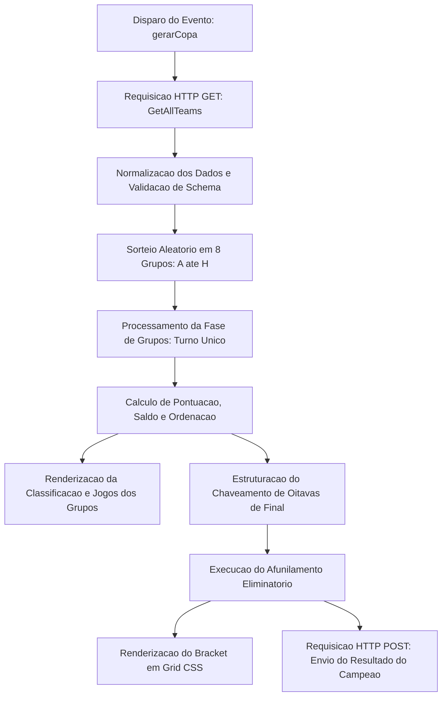

[README.md](https://github.com/user-attachments/files/35251228/README.md)
# Simulador da Copa do Mundo

Aplicacao web desenvolvida para simulacao integral de uma edicao da Copa do Mundo FIFA com 32 selecoes. O sistema integra consumo de API RESTful externa, chaveamento eliminatorio dinamico com renderizacao em CSS Grid e um modelo probabilistico baseado em inferencia fuzzy e tradicao historica das equipes.

---

## Indice

- [Visao Geral](#visao-geral)
- [Arquitetura do Sistema](#arquitetura-do-sistema)
- [Modelo Matematico e Algoritmo de Simulacao](#modelo-matematico-e-algoritmo-de-simulacao)
  - [Pesos Historicos](#pesos-historicos)
  - [Distribuicao de Placares e Inferencia Fuzzy](#distribuicao-de-placares-e-inferencia-fuzzy)
  - [Sorteio por Roleta de Monte Carlo](#sorteio-por-roleta-de-monte-carlo)
- [Regras de Negocio e Fases do Torneio](#regras-de-negocio-e-fases-do-torneio)
  - [Fase de Grupos](#fase-de-grupos)
  - [Fase Eliminatoria (Mata-Mata)](#fase-eliminatoria-mata-mata)
- [Integracao com API REST](#integracao-com-api-rest)
  - [Autenticacao e Identificacao](#autenticacao-e-identificacao)
  - [Endpoints](#endpoints)
- [Estrutura do Projeto](#estrutura-do-projeto)
- [Design de Interface e Estilizacao](#design-de-interface-e-estilizacao)
- [Guia de Execucao](#guia-de-execucao)
- [Especificacao das Tecnologias](#especificacao-das-tecnologias)
- [Autor](#autor)

---

## Visao Geral

O projeto foi concebido para simular o torneio em conformidade com o formato classico de 32 selecoes, desde o sorteio dos potes ate a definicao da equipe campea e o registro do resultado final.

A solucao foi implementada com padroes modernos de JavaScript (ES6+), sem frameworks pesados, demonstrando dominio de manipulacao dinamica do DOM, consumo assincrono de servicos via Fetch API, algoritmos de ordenacao e estruturacao visual responsiva via CSS Grid.

---

## Arquitetura do Sistema

O fluxo de dados da aplicacao obedece ao seguinte pipeline operacional:



---

## Modelo Matematico e Algoritmo de Simulacao

O simulador nao recorre a funcoes de probabilidade uniforme (random puro), mas implementa um motor estatistico calibrado com base no retrospecto historico dos mundiais.

### Pesos Historicos

Cada selecao campea do mundo recebe um peso equivalente ao seu numero de titulos:

| Selecao | Titulos Mundiais | Peso Atribuido ($P$) |
| :--- | :---: | :---: |
| Brasil | 5 | 5 |
| Alemanha | 4 | 4 |
| Italia | 4 | 4 |
| Argentina | 3 | 3 |
| Franca | 2 | 2 |
| Uruguai | 2 | 2 |
| Espanha | 1 | 1 |
| Inglaterra | 1 | 1 |
| Demais Participantes | 0 | 0 |

A diferenca de tradicao entre duas selecoes $A$ e $B$ e expressa por:

$$\Delta = P_A - P_B$$

### Distribuicao de Placares e Inferencia Fuzzy

A distribuicao base emprega frequencias observadas em partidas historicas de Copa do Mundo:

| Placar | Peso Base ($W_0$) |
| :---: | :---: |
| 1 x 0 | 180 |
| 2 x 1 | 150 |
| 1 x 1 | 120 |
| 0 x 0 | 100 |
| 2 x 0 | 90 |
| 3 x 1 | 50 |

Para cada partida, os pesos dos placares sao ajustados dinamicamente:

1. **Favorecimento do Favorito**:
   Se $\Delta > 0$ (Time $A$ favorito):
   - Placares com vitoria de $A$ ($gols_A > gols_B$):
     $$W = W_0 \times (1 + \Delta \times 0.4)$$
   - Placares com vitoria de $B$ ($gols_B > gols_A$):
     $$W = W_0 \times (1 - \Delta \times 0.15)$$

2. **Ajuste Simetrico para o Time B**:
   Se $\Delta < 0$ (Time $B$ favorito), a equacao aplica-se de forma analoga utilizando $|\Delta|$.

3. **Penalizacao de Empate por Disparidade**:
   Para confrontos com elevada discrepancia tecnica ($|\Delta| > 2$), a probabilidade de empate e atenuada:
   $$W_{\text{empate}} = W_{\text{empate}} \times 0.5$$

### Sorteio por Roleta de Monte Carlo

Com os pesos recalculados, o placar e obtido atraves de amostragem por roleta:

$$S = \sum_{i=1}^{N} W_i, \quad r \sim U(0, S)$$

O algoritmo itera sobre os placares acumulados ate que a variavel aleatoria atinja o intervalo correspondente, garantindo distribuicao proporcional aos pesos.

---

## Regras de Negocio e Fases do Torneio

### Fase de Grupos

- **Composicao**: 8 grupos com 4 participantes cada (Grupos A a H).
- **Formato**: Turno unico (todos contra todos), totalizando 6 partidas por grupo.
- **Sistema de Pontos**:
  - Vitoria: 3 pontos
  - Empate: 1 ponto
  - Derrota: 0 pontos
- **Criterios de Desempate e Ordenacao**:
  1. Total de pontos ganhos.
  2. Saldo de gols ($\text{gols marcados} - \text{gols sofridos}$).
  3. Sorteio aleatorio via permutacao estocastica.
- **Classificados**: 1o e 2o colocados de cada grupo avancam para a fase eliminatoria.

### Fase Eliminatoria (Mata-Mata)

A chave e montada com os cruzamentos tradicionais de Copa do Mundo:

- **Oitavas de Final**:
  - Jogo 1: 1o A vs 2o B
  - Jogo 2: 1o C vs 2o D
  - Jogo 3: 1o E vs 2o F
  - Jogo 4: 1o G vs 2o H
  - Jogo 5: 1o B vs 2o A
  - Jogo 6: 1o D vs 2o C
  - Jogo 7: 1o F vs 2o E
  - Jogo 8: 1o H vs 2o G
- **Quartas de Final**: Vencedores das oitavas adjacentes (4 partidas).
- **Semifinais**: Vencedores das quartas (2 partidas).
- **Final**: Vencedores das semifinais (1 partida).
- **Resolucao de Empates**: Em caso de igualdade no placar regulamentar, a partida e decidida por disputa de penaltis, com iterador que impede empates nas penalidades.

---

## Integracao com API REST

O sistema realiza comunicacao assincrona bidirecional com a API de avaliacao.

### Autenticacao e Identificacao

Todas as solicitacoes HTTP sao identificadas pelo cabecalho customizado:
```http
git-user: Joao-Ricardo-S-Magalhaes
```

### Endpoints

#### 1. Consulta de Selecoes
- **Metodo**: `GET`
- **URI**: `https://development-internship-api.geopostenergy.com/WorldCup/GetAllTeams`
- **Header**: `git-user: Joao-Ricardo-S-Magalhaes`
- **Tratamento de Payload**: O client aceita respostas em formato de array nativo ou objeto com propriedade `teams`, normalizando as chaves `token`/`id` e `nome`/`name`.

#### 2. Envio do Resultado da Final
- **Metodo**: `POST`
- **URI**: `https://development-internship-api.geopostenergy.com/WorldCup/FinalResult`
- **Headers**:
  ```http
  Content-Type: application/json
  git-user: Joao-Ricardo-S-Magalhaes
  ```
- **Corpo da Requisicao (JSON)**:
  ```json
  {
    "equipeA": "identificador-equipe-1",
    "equipeB": "identificador-equipe-2",
    "golsEquipeA": 2,
    "golsEquipeB": 1,
    "golsPenaltyTimeA": 0,
    "golsPenaltyTimeB": 0
  }
  ```

---

## Estrutura do Projeto

```text
.
├── index.html       # Estrutura semantica, declaracao do viewport e containers DOM
├── style.css        # Folha de estilo, definicao de temas, grid e responsividade
├── simulador.js     # Motor logico, requisicoes assincronas e controle de fluxo
└── README.md        # Especificacao tecnica e documentacao operacional
```

---

## Design de Interface e Estilizacao

- **CSS Grid Multidimensional**: O bracket eliminatorio e estruturado em uma grade de 5 colunas por 16 linhas. O posicionamento das partidas nas rodadas sucessivas e calculado matematicamente:
  - Oitavas: `grid-row: (i * 2 + 2) / span 2`
  - Quartas: `grid-row: (i * 4 + 3) / span 2`
  - Semifinais: `grid-row: (i * 8 + 5) / span 2`
  - Final e Campeao: `grid-row: 9 / span 2`
- **CSS Custom Properties**: Uso de `--coluna` para projecao automatica dos cards em suas respectivas colunas temporais.
- **Hierarquia Visual**:
  - Fundo principal: `#0b132b` (Deep Navy)
  - Superficie de cards: `#1c2541` com bordas `#2e3a59`
  - Acentos de dados (placar e penaltis): `#ff9f1c`
  - Identificadores de colunas: `#4cc9f0`
  - Destaque do Campeao: Gradiente linear com borda dourada `#ffd700` e escala expandida (`scale(1.1)`).

---

## Guia de Execucao

Por se tratar de uma aplicacao front-end pura desenvolvida em padroes web abertos, nao ha etapas de transpilacao, empacotamento ou instalacao de dependencias via gerenciadores de pacotes.

### Metodo 1: Servidor HTTP Local (Recomendado)

Para mitigar eventuais restricoes de seguranca do navegador referentes a requisicoes `fetch` (CORS/file protocol):

Utilizando **Python 3**:
```bash
python3 -m http.server 8000
```
Acesse no navegador: `http://localhost:8000`

Utilizando **Node.js**:
```bash
npx serve .
```

Utilizando a extensao **Live Server** (Visual Studio Code):
1. Abra o diretorio do projeto no VS Code.
2. Clique com o botao direito em `index.html`.
3. Selecione a opcao "Open with Live Server".

### Metodo 2: Abertura Direta

Abra diretamente o arquivo `index.html` em qualquer navegador compativel com padroes ECMAScript 6+ (Chrome, Firefox, Safari, Edge).

---

## Especificacao das Tecnologias

- **HTML5**: Semantica estrutural (`<main>`, `<section>`, `<table>`, `<svg>`).
- **CSS3**: Modulo Grid Layout nivel 2, Flexbox, variaveis CSS nativas, transformacoes 2D e pseudo-classes.
- **JavaScript (ECMAScript 2020+)**:
  - Funcoes assincronas e Promises (`async`, `await`, `fetch`).
  - Metodos funcionais de alta ordem (`Array.prototype.map`, `filter`, `reduce`, `sort`).
  - Operadores de desestruturacao e espalhamento (*spread/rest*).
  - API de manipulacao de DOM e eventos assincronos.

---

## Autor

Desenvolvido por **Joao Ricardo S. Magalhaes**  
Identificador Git: `Joao-Ricardo-S-Magalhaes`
